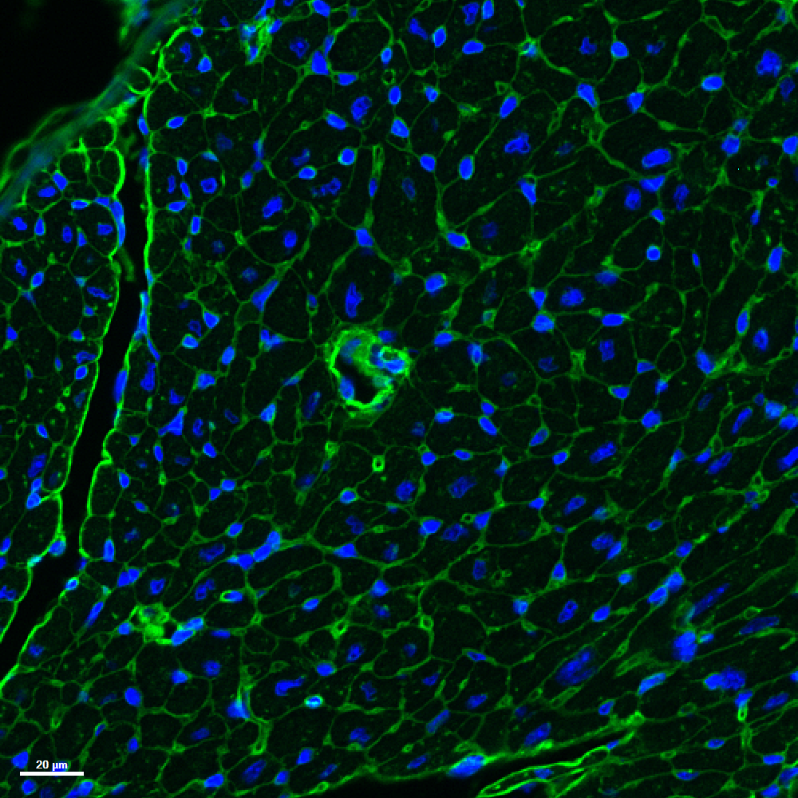
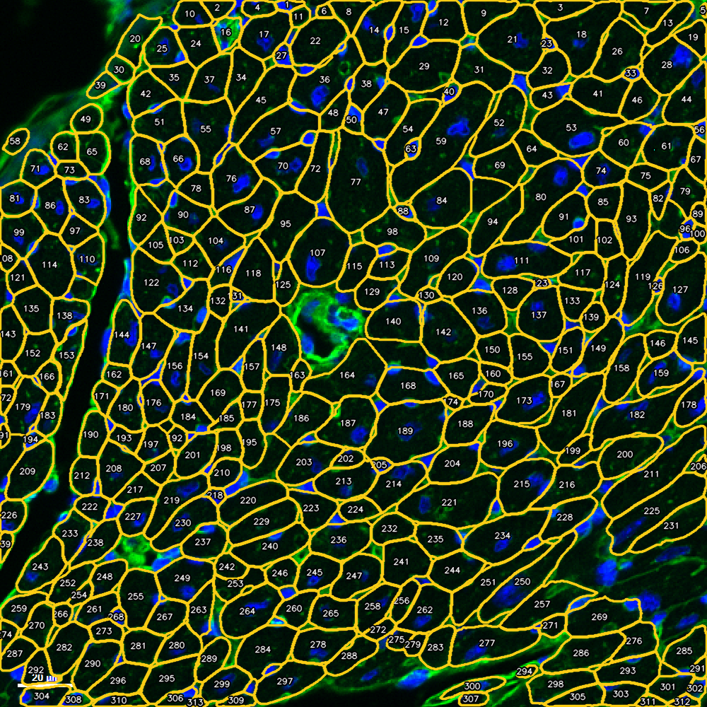
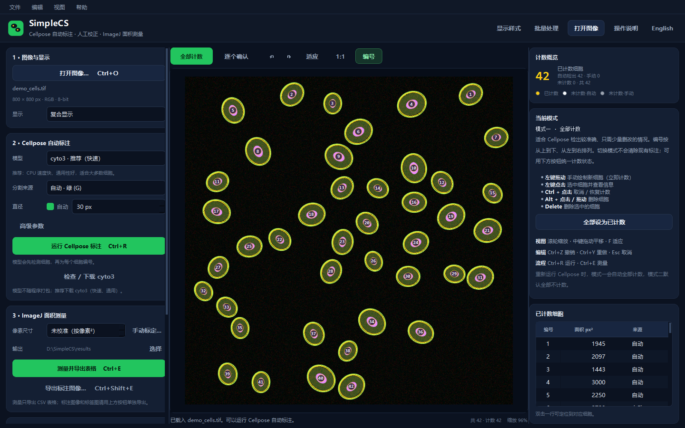
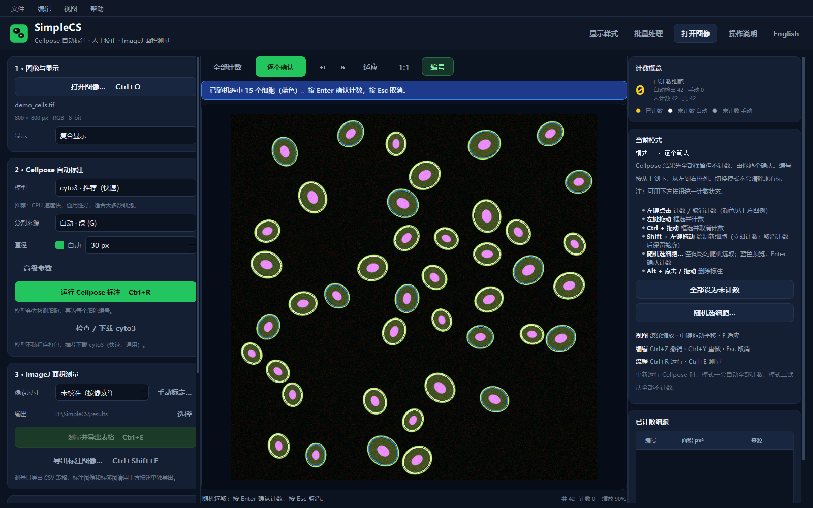
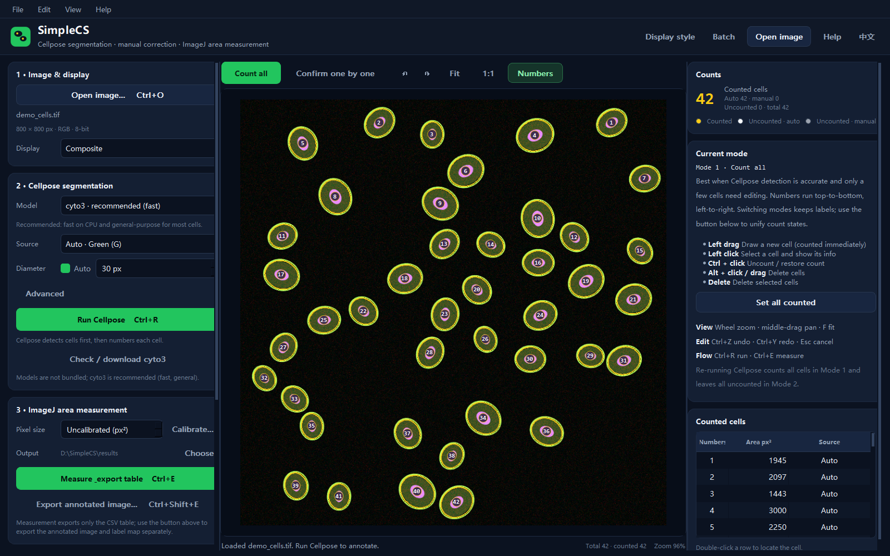
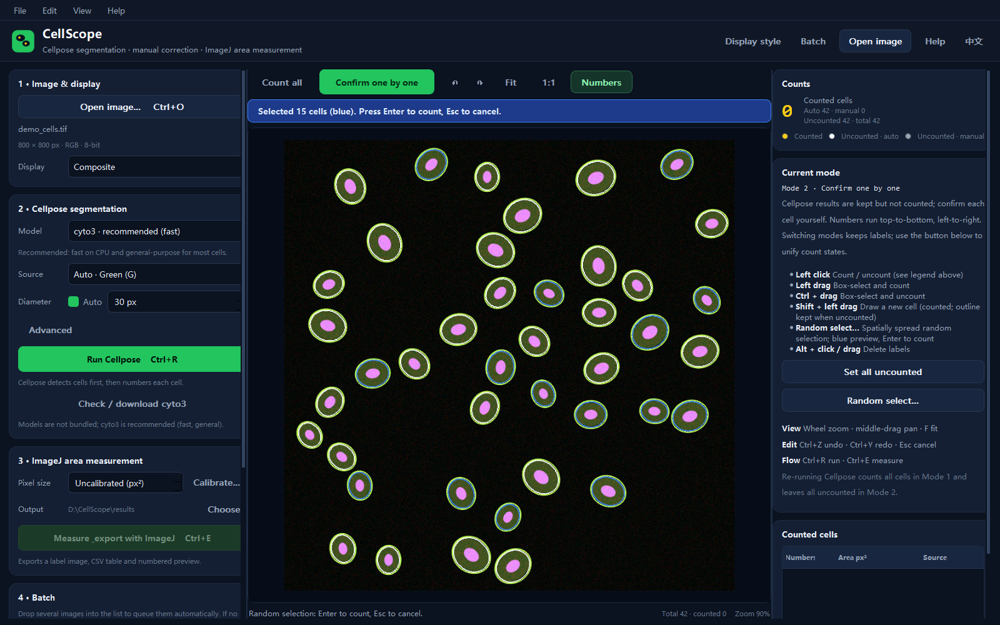

<a id="中文"></a>

# SimpleCellSegmentation

<p align="center"><b>中文</b> | <a href="#english">English</a></p>

<p align="center">
  
  
</p>
<p align="center"><sub>标注前 / 标注后 · 示例图像来自天津医科大学 YY Lab；版权归原实验室所有。</sub></p>
<p align="center"><a href="docs/yy_lab_before.png">查看标注前大图</a> · <a href="docs/yy_lab_after.png">查看标注后大图</a></p>

**Cellpose + ImageJ 细胞计数与面积测量桌面工具。**

> **说明：SimpleCellSegmentation 只是一个更方便的操作工具 GUI。识别/分割工具来自 Cellpose，面积计算工具来自 ImageJ；本项目不重新实现分割或面积算法。**

SimpleCellSegmentation（简称 **SimpleCS**）把 Cellpose 自动分割、人工校正计数和 ImageJ 面积测量整合到一个独立界面中，适合 DAPI / WGS（膜染色）等 2D 显微图像。

- Cellpose 自动标注，支持编号；人工增删细胞、切换计数状态
- 模式一：自动全部计数；模式二：逐个确认
- 只显示细胞边缘或半透明填充，可自定义颜色、透明度、边缘粗细
- 调用 ImageJ 1.54g（headless）导出细胞 1…N 的面积表
- 模型权重不随程序分发，在界面内按需下载（推荐 cyto3）



---

## 功能

- 支持 TIFF / PNG / JPEG / BMP；多通道复合显示、单通道灰度
- Cellpose 模型：`cyto3`（推荐）、`cyto2`、`cyto`、`nuclei`、`Cellpose-SAM v2`、`Cellpose-SAM v1`
- 自动直径 / 手动直径、流阈值、细胞概率阈值、最小面积
- 两种人工校正模式，支持撤销/重做、框选计数/取消、手动绘制细胞；模式可自由切换，无需重跑 Cellpose；模式二支持空间均匀随机抽样
- “显示样式”面板：非模态、实时预览；包含“是否填充细胞内部”，按状态设置边缘/填充颜色、透明度、边缘粗细，关闭后自动保存
- 界面支持 **中文 / English** 切换（顶部语言按钮）；本 README 也可通过顶部链接切换中英文
- 手动标定比例：输入已知真实长度（如 20 µm），在图上点两点，自动得到 µm/px；与水平/垂直偏差 ≤5° 时可一键校正为横线/竖线
- 批量处理：拖入多张图像自动排队；第一张完成后可边校正边让后续图像在后台继续自动标注
- ImageJ 测量与图像导出分离：测量只导出 CSV 面积表；标注图像和标签图用 **“导出标注图像…”** 单独生成
- 支持像素尺寸校准（µm/px）

---

## 快速开始

### 方式一：一键安装（推荐）

1. 下载本仓库（Code → Download ZIP）并解压。
2. 双击 **`SimpleCellSegmentation-Setup.exe`**（带 SimpleCellSegmentation 图标的安装启动器；也可以运行 `Install_SimpleCellSegmentation.bat`）。
3. 按提示选择安装目录、可选模型（默认 cyto3）和是否安装 ImageJ。
4. 安装完成后使用桌面 / 开始菜单中的 **SimpleCellSegmentation** 快捷方式启动。

安装程序会：

- 检测 Python 3.10–3.12；如果没有，自动下载安装 Python 3.10（当前用户，不需要管理员权限）
- 创建独立 Python 虚拟环境并安装依赖（PyTorch CPU、PyQt5 等）
- 下载并安装 ImageJ 1.54g 到安装目录
- 按你的选择下载 Cellpose 模型到 `%USERPROFILE%\.cellpose\models`
- 创建快捷方式

> 安装需要网络连接；首次下载依赖可能需要 10–30 分钟，请保持窗口打开。
> SimpleCellSegmentation-Setup.exe 使用与应用相同的图标；如果 Windows SmartScreen 提示未知发布者，可选择“更多信息 → 仍要运行”，或直接运行 Install_SimpleCellSegmentation.bat。  
> 安装目录默认：`%LOCALAPPDATA%\SimpleCellSegmentation`，不需要管理员权限。

### 方式二：手动安装

要求：

- Windows 10/11 64-bit
- Python 3.10–3.12
- ImageJ 1.54g（`ij.jar` + `jre`）
- 网络（下载 Python 依赖和 Cellpose 模型）

```bat
python -m pip install -r requirements.txt
```

把 ImageJ 1.54g 放到程序目录下的 `ImageJ\`（包含 `ij.jar` 和 `jre\bin\java.exe`），或设置环境变量 `IMAGEJ_HOME` 指向 ImageJ 目录。

运行：

```bat
Start_SimpleCellSegmentation.bat
```

或：

```bat
python app.py
```

---

## 模型

模型权重不包含在本仓库中。首次使用在左侧选择模型，点击 **“检查 / 下载 当前模型”**；也可以运行：

```bat
python download_model.py --model cyto3 --dest "%USERPROFILE%\.cellpose\models"
```

| 模型 | 大小 | 说明 |
| --- | --- | --- |
| `cyto3` | ~26 MB | **推荐**，速度快、通用性好 |
| `cyto2` | ~26 MB | 旧版细胞模型 |
| `cyto` | ~26 MB | 初代细胞模型 |
| `nuclei` | ~26 MB | 细胞核模型；请选 DAPI/蓝色通道 |
| `Cellpose-SAM v2` | ~1.2 GB | 泛化最好，CPU 较慢 |
| `Cellpose-SAM v1` | ~1.2 GB | 旧版 Cellpose-SAM |

模型保存到 `%USERPROFILE%\.cellpose\models`。Cellpose 模型权重遵循其原始许可（CC-BY-NC）。

---

## 使用流程

### 1. 打开图像

`文件 → 打开图像`，或把图像拖入窗口。多通道图像会自动合成显示；左侧“显示”可切换复合/单通道灰度。

### 2. 运行 Cellpose

- **模型**：默认 `cyto3`（推荐）；需要整体细胞用膜/绿色通道，细胞核用 DAPI/蓝色通道
- **分割来源**：`自动` 默认第二个通道；也可以选复合图像或指定通道
- **直径**：默认自动；细胞大小一致时可手动填写
- **高级参数**：流阈值、细胞概率阈值、最小面积

CPU 下 Cellpose-SAM 处理 1000×1000 约 1–3 分钟，`cyto3` 通常几秒到几十秒。

### 3. 人工校正

两种模式可以随时切换；Cellpose 标注和已有计数都会保留，**不需要重新运行**。若希望现有细胞按当前模式统一状态，点击模式卡下方的“全部设为已计数 / 全部设为未计数”（可撤销）；模式本身只影响后续鼠标操作和下一次运行 Cellpose 的初始计数状态。

**模式一 · 全部计数**：检出细胞全部计数。

| 操作 | 效果 |
| --- | --- |
| 左键拖动 | 手动绘制新细胞（立即计数） |
| 左键点击 | 选中并查看细胞 |
| Ctrl + 点击 | 取消 / 恢复计数 |
| Alt + 点击 / 拖动 | 删除细胞 |
| Delete | 删除选中细胞 |

**模式二 · 逐个确认**：检出细胞默认不计数（白色轮廓）。

| 操作 | 效果 |
| --- | --- |
| 左键点击 | 计数 / 取消计数 |
| 左键拖动框选 | 框内细胞计数 |
| Ctrl + 拖动框选 | 框内细胞取消计数 |
| Shift + 左键拖动 | 绘制新细胞（立即计数） |
| 随机选细胞… | 空间均匀随机选取指定数量：先蓝色预览，按 Enter 确认计数，Esc 取消 |
| Alt + 点击 / 拖动 | 删除标注 |

**随机选细胞**：选取后先以蓝色预览，按 Enter 确认计数，按 Esc 取消。


| Delete | 删除选中细胞 |

默认颜色：黄色 = 已计数，白色 = 自动未计数，灰色 = 手动未计数；可在“显示样式”中修改。

编号按从上到下、从左到右排列；删除或取消计数后自动重排。ImageJ 导出的细胞 1…N 与屏幕编号一致。

### 4. 显示样式

顶部 **“显示样式”** 按钮会打开一个**非模态**面板：

- 调整颜色、透明度、边缘粗细时，主窗口和图像**立即实时变化**
- 面板打开期间仍可缩放、标注、切换模式、运行其他功能
- 不需要“确定”；直接关闭面板即可，设置会自动保存
- 已计数 / 自动未计数 / 手动未计数三组状态可分别设置
- 边缘和填充颜色默认联动，可取消后分开调整

“填充细胞内部”也在样式面板中控制；关闭时只显示细胞边缘。

### 5. ImageJ 面积测量

**手动标定比例**：

1. 在“像素尺寸”右侧点击 **“手动标定…”**。
2. 输入已知真实长度（例如 `20` µm）。
3. 在图像上点击两点，画出这条已知长度对应的线段。
4. 如果线段与水平/垂直方向偏差在 **5° 以内**，程序会询问是否校正为水平线/垂直线；确认后按校正后的长度计算。
5. 程序自动计算 `真实长度 ÷ 像素长度`，填入 µm/px；也可以继续手动修改数值。

设置像素尺寸（`0` 表示按像素²），选择输出文件夹，点击 **“测量并导出表格”**。这个按钮只生成面积 CSV，不生成图像。

**导出最终标注图像**：点击 **“导出标注图像…”**（或 `Ctrl+Shift+E`），选择 PNG 保存位置。程序会直接从当前标注生成：

```
<图像名>_annotated.png       # 带编号和轮廓的最终标注图
<图像名>_labels.tif          # 1…N 标签图
```

这一步不需要运行 ImageJ。测量和图像导出可以分别进行；批量结果载入后也可以单独导出图像。

```
SimpleCellSegmentation_results/
  <图像名>_cell_areas.csv    # 测量并导出表格
  <图像名>_annotated.png     # 导出标注图像
  <图像名>_labels.tif        # 导出标注图像
```

CSV 表头为 `Cell,Area_px2` 或 `Cell,Area_um2`。面积由 ImageJ 1.54g 的 `ImageStatistics.AREA` 计算。

### 6. 批量处理

- 点击顶部 **“批量处理”**，或把多张图像一起拖到主窗口/左侧“4 · 批量处理”列表。
- 程序按当前 Cellpose 参数依次自动标注；参数在文件加入队列时记录。
- 如果当前没有打开图像，第一张完成后会自动载入；之后可以一边人工校正第一张，一边让后面的图像继续在后台处理。
- 其他完成的结果显示为 **“待校正”**。点击列表项即可切换；切换前当前图像的标注会自动保存，切回来会恢复。
- 批量处理只负责自动标注；需要面积或标注图时，载入对应图像后分别点击 **“测量并导出表格”** 或 **“导出标注图像…”**。
- “清空”会停止正在处理的任务并清空列表；已保存到临时目录的标注不会立即删除，但不再显示在队列中。

---

## 快捷键

| 快捷键 | 功能 |
| --- | --- |
| Ctrl+O | 打开图像 |
| Ctrl+R | 运行 Cellpose |
| Ctrl+E | 测量并导出表格 |
| Ctrl+Shift+E | 导出标注图像 |
| Ctrl+Z / Ctrl+Y | 撤销 / 重做 |
| Ctrl+S / Ctrl+Shift+O | 保存 / 载入标注 |
| F | 适应窗口 |
| 1 / 2 | 切换模式一 / 模式二 |
| Esc | 取消当前绘制/框选/手动标定 |
| 滚轮 | 缩放 |
| 中键 / 右键 / 空格+左键 | 平移 |

---

## 目录结构

```
SimpleCellSegmentation-open/
  app.py                     程序入口
  cellpose_worker.py         Cellpose 子进程 worker
  download_model.py          模型下载
  cellcounter/
    mainwindow.py            主窗口
    viewer.py                图像查看器与交互
    model.py                 标签存储、编辑、撤销
    imaging.py               图像/通道读取
    imagej.py                ImageJ headless 测量
    overlay_style.py         显示样式数据与持久化
    style_dialog.py          非模态实时样式面板
    batch.py                 批量队列与拖放列表
    models_info.py           模型元数据
    theme.py                 主题
  vendor/
    cp3/cellpose             Cellpose 3
    cp4/cellpose             Cellpose 4 / Cellpose-SAM
  assets/                    图标
  installer 文件：
    SimpleCellSegmentation-Setup.exe      带 SimpleCellSegmentation 图标的安装启动器
    Install_SimpleCellSegmentation.bat    一键安装入口（备用）
    Install_SimpleCellSegmentation.ps1    安装程序
```

---

## 依赖

见 `requirements.txt`。主要组件：PyQt5、PyTorch、NumPy、SciPy、OpenCV、tifffile、imagecodecs、fastremap、natsort、roifile、fill-voids、segment_anything、tqdm。

Cellpose 代码已随仓库放在 `vendor/` 中，无需额外安装 Cellpose 包。

---

## 许可

- 本项目代码：**GPL-3.0**（因为使用了 GPL 版的 PyQt5）。详见 `LICENSE`。
- Cellpose / Cellpose-SAM：BSD-3-Clause（HHMI）。模型权重遵循 CC-BY-NC。
- ImageJ：NIH，见其官方许可。
- 其他第三方组件见 `THIRD_PARTY_NOTICES.md`。

如果需要在非 GPL 项目中使用本代码，需要替换 PyQt5 为 LGPL 的 PySide6，或取得 PyQt 商业许可。

---

## 致谢

- [Cellpose](https://github.com/MouseLand/cellpose) — MouseLand / HHMI
- [ImageJ](https://imagej.net/ij/) — NIH
- PyTorch、PyQt、OpenCV、SciPy 等开源项目

---

## 作者与首个版本

- 首个版本由 **天津医科大学 Huajiefang** 创建。
- 开发过程中使用了 **DeepSeek V4.1 Flash 1017** 辅助。

---

<a id="english"></a>

# SimpleCellSegmentation (English)

<p align="center"><a href="#中文">中文</a> | <b>English</b></p>

<p align="center">
  
  
</p>
<p align="center"><sub>Before / after annotation · Sample image courtesy of Tianjin Medical University YY Lab; copyright remains with the lab.</sub></p>
<p align="center"><a href="docs/yy_lab_before.png">Full-size before</a> · <a href="docs/yy_lab_after.png">Full-size after</a></p>

**A desktop GUI for Cellpose segmentation + manual correction + ImageJ area measurement.**

> **Important: SimpleCellSegmentation is only a convenience GUI. Cell detection/segmentation is powered by Cellpose; area calculation is powered by ImageJ. This project does not reimplement the segmentation or measurement algorithms.**

SimpleCellSegmentation (abbreviated **SimpleCS**) combines automatic Cellpose segmentation, manual cell correction and ImageJ area measurement in a single window. It is intended for 2D microscopy images such as DAPI / WGS (membrane-stained) cells.



## Highlights

- Cellpose auto-segmentation with numbered cells; add/delete cells and toggle count states manually.
- Mode 1 counts all detected cells; Mode 2 asks you to confirm cells one by one. Switching modes keeps labels and does not re-run Cellpose.
- Manual scale calibration: enter a known real length (e.g. 20 µm), click two points, and get µm/px. If the line is within 5° of horizontal/vertical, the app offers to snap it.
- Edge-only or translucent fill display, with per-state colours, opacity and edge width. Fill on/off is inside the style panel, which is **non-modal and live**.
- Batch queue: drop multiple images and let SimpleCellSegmentation annotate them in the background; edit the first result while the next images are still processing.
- ImageJ 1.54g (headless) measures and exports a cell 1…N area table. Annotated PNG and label TIFF images are exported separately with **Export annotated image…**, without re-running ImageJ.
- Interface and this README are available in **中文 / English**. Use the language button in the app header.
- Model weights are not bundled; download them from the app (cyto3 recommended).



## Quick start

### Option A: one-click installer (recommended)

1. Download / clone this repository and extract it.
2. Double-click **`SimpleCellSegmentation-Setup.exe`** (installer launcher with the SimpleCellSegmentation icon; `Install_SimpleCellSegmentation.bat` also works).
3. Choose the install folder, optional models (cyto3 by default) and whether to install ImageJ.
4. Launch **SimpleCellSegmentation** from the desktop / Start menu shortcut.

The installer checks/downloads Python 3.10, creates a virtual environment, installs PyTorch CPU / PyQt5 and other dependencies, downloads ImageJ 1.54g, optionally downloads Cellpose models to `%USERPROFILE%\.cellpose\models`, and creates a shortcut. Internet access is required; no administrator rights are normally needed.

The `SimpleCellSegmentation-Setup.exe` launcher uses the same icon as the app. If Windows SmartScreen shows an unknown publisher warning, choose **More info → Run anyway**, or run `Install_SimpleCellSegmentation.bat` instead.

### Option B: run from source

Requirements: Windows 10/11 64-bit, Python 3.10–3.12, ImageJ 1.54g (`ij.jar` + `jre`), and internet for Python packages/models.

```bat
python -m pip install -r requirements.txt
```

Place ImageJ in `ImageJ\` next to the app (with `ij.jar` and `jre\bin\java.exe`), or set `IMAGEJ_HOME`. Then run `Start_SimpleCellSegmentation.bat`.

## Workflow

1. **Open an image** (`Ctrl+O`, or drag a single image onto the window). TIFF / PNG / JPEG / BMP and multi-channel images are supported.
2. **Run Cellpose** (`Ctrl+R`). Choose the model, source channel, diameter and advanced parameters. `cyto3` is the recommended general model. Model files are not bundled.
3. **Correct cells** using Mode 1 or Mode 2. Switching modes keeps labels and counts; use **Set all counted / Set all uncounted** to unify states. Undo/redo is supported.
4. **Calibrate the scale** in the ImageJ card: click **Calibrate…**, enter the known real length, then click the two endpoints. If the line is within 5° of horizontal/vertical, confirm the snap; the computed µm/px is filled in.
5. **Adjust display style** using the **Display style** button in the header. The panel is non-modal and changes are applied live; close it to save.
6. **Batch processing**: click **Batch** or drag several images onto the window / batch list. Files are queued automatically using the Cellpose settings at the time they were added. If no image is open, the first finished result is loaded automatically; you can correct it while later images continue in the background. Other results appear as **Needs review**; click to switch. Current edits are saved when you switch.
7. **Measure with ImageJ** (`Ctrl+E`) for the loaded image. This exports only the cell 1…N area CSV. To export the final annotated image, use **Export annotated image…** (`Ctrl+Shift+E`); it writes `<image>_annotated.png` and `<image>_labels.tif` directly from the current labels, without ImageJ.

## Batch notes

- Processing is sequential in the background so it does not compete with editing for all CPU cores.
- Manual Cellpose is paused while a batch worker is running; manual correction of the loaded image still works.
- Each batch file remembers the settings captured when it was added.
- Batch only performs automatic annotation. On each loaded result, use **Measure & export table** for areas or **Export annotated image…** for the image.
- **Clear** stops the running task and clears the list; saved temporary labels are not deleted immediately.

## Models

`cyto3` (recommended), `cyto2`, `cyto`, `nuclei`, `Cellpose-SAM v2`, `Cellpose-SAM v1`. Weights are downloaded on demand into `%USERPROFILE%\.cellpose\models`; they are not included in this repository.

## Output

```
SimpleCellSegmentation_results/
  <image>_cell_areas.csv      # measure & export table
  <image>_annotated.png       # export annotated image
  <image>_labels.tif          # export annotated image
```

## Project layout

```
SimpleCellSegmentation-open/
  app.py                      entry point
  cellpose_worker.py          Cellpose subprocess worker
  download_model.py           model downloader
  cellcounter/                main window, viewer, model, i18n, style, batch, ImageJ helpers
  vendor/                     bundled Cellpose source
  docs/                       screenshots
  SimpleCellSegmentation-Setup.exe         installer launcher with SimpleCellSegmentation icon
  Install_SimpleCellSegmentation.bat/.ps1  installer (fallback)
```

## Licensing

- Application code: **GPL-3.0** (because PyQt5 is GPL). See `LICENSE`.
- Cellpose / Cellpose-SAM: BSD-3-Clause (HHMI); model weights are CC-BY-NC.
- ImageJ: NIH; see its official license.
- Other third-party components are listed in `THIRD_PARTY_NOTICES.md`.

## Acknowledgements

- [Cellpose](https://github.com/MouseLand/cellpose) — MouseLand / HHMI
- [ImageJ](https://imagej.net/ij/) — NIH
- PyTorch, PyQt, OpenCV, SciPy and other open-source projects

---

## Author & first version

- The first version was created by **Huajiefang, Tianjin Medical University**.
- Development used **DeepSeek V4.1 Flash 1017** as an AI coding assistant.
